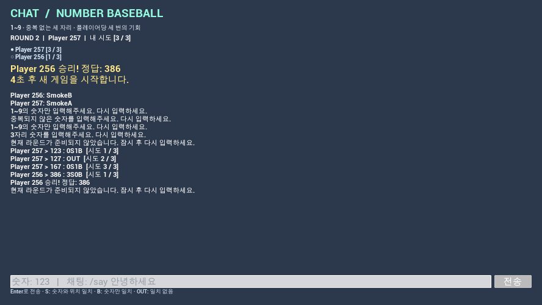
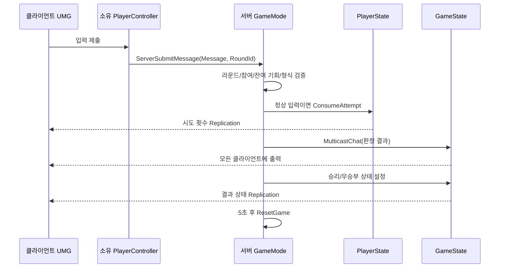

# CHAT — 숫자 야구

Unreal Engine **5.5.4 / C++ / UMG** 기반 멀티플레이 숫자 야구 과제입니다.
기존 CHATX 채팅 프로젝트에서 출발해 프로젝트·모듈명을 CHAT으로, 모든 CX C++ 클래스 접두사를 CHAT으로 변경했습니다.



상세 검증 내용은 [검증 기록](Docs/Verification.md)을 참고하세요.

## 실행

1. UE **5.5**와 Visual Studio의 C++ 게임 개발 도구를 설치합니다.
2. `CHAT.uproject`를 열고 모듈 빌드 요청을 승인합니다. 필요하면 프로젝트 파일에서 **Generate Visual Studio project files**를 실행한 후 `Development Editor / Win64`로 빌드합니다.
3. 시작 맵은 `/Game/CHAT/Maps/L_Chat`입니다.
4. 에디터 Play 설정에서 **Number of Players = 2**, **Net Mode = Play As Listen Server**, **New Editor Window (PIE)**를 선택합니다.
5. 두 창 중 입력창을 선택하고 세 자리 숫자를 입력한 뒤 Enter 또는 전송 버튼을 누릅니다.

에디터 밖의 두 게임 창으로 실행하려면 PowerShell에서 다음을 실행합니다. 엔진 설치 경로가 다르면 `-EngineRoot`를 지정합니다.

```powershell
.\Scripts\Play-Local.ps1
```

호스트 시작이 느려 클라이언트가 연결되지 않으면 클라이언트 콘솔에서 `open 127.0.0.1:17777`로 다시 연결합니다. 서로 다른 PC에서는 호스트의 LAN IP로 연결하며 같은 빌드를 사용해야 합니다.

## 조작과 규칙

| 입력 | 동작 |
| --- | --- |
| `123` | 정답 제출. 정상 입력만 기회 1회 소모 |
| `/say 안녕하세요` | 전체 채팅. 기회를 소모하지 않음 |
| `abc`, `112`, `012`, `12` | 잘못된 입력 안내. 기회 유지 |

- 정답은 서버에서 생성한 **1~9 사이의 중복 없는 세 자리 숫자**입니다.
- 숫자와 위치가 같으면 S, 숫자만 있으면 B, 모두 없으면 OUT입니다.
- 각 플레이어에게 3회 기회가 있습니다. 화면과 판정 메시지의 `[현재 시도 / 최대 시도]`는 **사용한 횟수**입니다.
- 3S를 먼저 달성한 플레이어가 즉시 승리합니다. 마지막 기회의 정답도 승리입니다.
- 라운드 참가자 전원이 기회를 소진하면 무승부입니다.
- 결과 공지를 5초간 표시한 뒤 새 정답과 각 플레이어의 0/3 상태로 재시작합니다.
- 참가자 2명 이상이면 시작합니다. 진행 중 접속자는 다음 라운드부터 참여하며 채팅은 가능합니다.
- 진행 중 접속자가 2명 미만으로 줄면 라운드를 취소하고 결과 표시 후 대기합니다.
- 기회가 소진되거나 결과 표시 중에도 채팅은 가능합니다. 정답 제출은 서버가 거절합니다.
- 최근 채팅·판정 기록 최대 100개는 화면에 유지합니다. 게임 판정 상태와 기회는 매 라운드 초기화합니다.

## 필수 구현 체크리스트

- [x] Server RPC와 NetMulticast를 이용한 멀티플레이 채팅
- [x] GameModeBase에서 난수 생성, 입력 검사, S/B/OUT 판정
- [x] 0·문자·중복·길이 오류를 서버에서 검증하고 기회 유지
- [x] PlayerState의 개인별 시도 횟수 복제와 Getter
- [x] 화면 및 판정 메시지에 현재/최대 시도 표시
- [x] 3S 승리, 전원 기회 소진 무승부
- [x] UMG 결과 공지와 5초 후 자동 리셋
- [x] 순수 판정 C++ 함수 라이브러리
- [x] 구현 구조, 사용법, 검증 방법 문서화

도전 기능인 턴제와 턴 제한 시간은 이번 범위에 포함하지 않았습니다. 결과 화면의 5초는 재시작 대기 시간입니다.

## 데이터 흐름과 클래스 역할



| 클래스 | 책임 |
| --- | --- |
| `ACHATGameModeBase` | 서버 전용 정답 보관, 참가자 관리, 검증과 판정 호출, 종료 및 리셋 |
| `UCHATNumberLibrary` | `GenerateRandomNumbers`, `ValidateInput`, `CheckAnswer` 순수 규칙 |
| `ACHATPlayerController` | 소유 클라이언트의 Server RPC 입구, 개인 Client RPC 안내, 로컬 위젯 생성 |
| `ACHATPlayerState` | `AttemptsUsed`, 참가 여부를 서버에서 변경하고 복제 |
| `ACHATGameState` | 라운드 ID·상태·결과 공지 복제, 전체 채팅 Multicast |
| `UCHATChatInput` | C++로 구성한 UMG 입력창·기록·점수판·공지 화면 |

### 구현에서 주의한 점

1. GameMode는 클라이언트에 존재하지 않으므로, 클라이언트가 소유하는 PlayerController를 통해 Server RPC를 호출합니다.
2. 정답은 GameMode에만 있으며 복제하지 않습니다. 개발 빌드의 서버 Output Log에만 정답을 출력합니다.
3. 결과 공지는 일회성 RPC에만 의존하지 않고 GameState 속성으로 복제합니다. 중도 접속자도 현재 상태를 알 수 있습니다.
4. 클라이언트는 시도 횟수·이름·정답 결과를 제출할 수 없습니다. 서버가 Sender의 PlayerState를 찾아 처리합니다.
5. 잘못된 입력은 `ConsumeAttempt()` 전에 거절합니다. 정상 입력은 승리 여부와 관계없이 한 번만 소모합니다.
6. 서버가 결과 상태로 전환한 후 도착한 입력과 이전 라운드 ID를 가진 지연 RPC는 거절합니다.
7. 입력은 200자로 제한하고 서버에서는 0.2초 미만 간격의 연속 요청을 무시합니다.
8. UI는 0.1초 간격으로 복제된 상태를 읽습니다. 서로 다른 액터의 복제 도착 순서에 의존하지 않습니다.
9. 기존 블루프린트는 Unreal 에디터로 재저장했습니다. Config의 `CoreRedirects`는 이전 `/Script/CHATX.CX...` 참조를 새 클래스에 연결하기 위한 호환 정보입니다. 현재 C++ 클래스에는 CX 접두사가 없습니다.

## 검증

에디터 **Tools → Test Automation**(Session Frontend의 Automation 탭)에서 `CHAT.Rules`를 실행하거나 Output Log에서 다음 명령을 실행합니다.

```text
Automation RunTests CHAT.Rules
```

- Validation: 길이, 문자, 중복, 0, 공백, 전각 숫자, 개행 거절
- Scoring: 예제 및 가능한 정답 504개 × 입력 504개, 총 **254,016개 조합** 검증
- RandomNumbers: 1,000회 생성 결과의 규칙 준수 확인

실제 서버 1개와 클라이언트 2개를 실행하는 통합 테스트:

```powershell
.\Scripts\Test-Network.ps1 -Scenario Win
.\Scripts\Test-Network.ps1 -Scenario Draw
# 결과 화면 캡처를 함께 저장하려면 -Capture 추가
```

테스트는 채팅 양방향 전달, 잘못된 입력의 기회 유지, 이전 라운드 요청 거절, 개인별 횟수 독립성, 4번째 입력 거절, 결과 복제, 자동 리셋을 두 클라이언트에서 검사합니다. 로그는 `Saved/NetworkTests`에 저장됩니다. `CHATSmokeServer` 고정 정답은 **WITH_EDITOR 조건의 테스트 실행에서만** 켜지며 일반 실행과 패키징 게임에서는 사용하지 않습니다.

## 제출 시연 순서

1. 2인 접속 및 `/say` 채팅의 양쪽 표시를 확인합니다.
2. `12`, `abc`, `112`, `012`를 입력해 안내와 0/3 유지 상태를 보여줍니다.
3. 정상 입력을 제출해 S/B/OUT과 증가한 시도 횟수를 보여줍니다.
4. 서버 Output Log의 정답을 다른 플레이어가 입력해 승리 공지를 보여줍니다.
5. 5초 후 새 라운드와 양쪽 0/3을 확인합니다.
6. 다음 라운드에서 양쪽 모두 정답이 아닌 숫자를 세 번씩 입력해 무승부와 리셋을 보여줍니다.

과제 제출용 MP4 녹화는 별도로 진행해야 합니다. 저장소 공개 범위는 비공개이므로 제출 시 평가자가 접근할 수 있도록 설정해야 합니다.

## 참고

- [Epic: Game Mode와 Game State](https://dev.epicgames.com/documentation/en-us/unreal-engine/game-mode-and-game-state-in-unreal-engine?application_version=5.5)
- [Epic: Remote Procedure Calls](https://dev.epicgames.com/documentation/en-us/unreal-engine/remote-procedure-calls-in-unreal-engine?application_version=5.5)
